<div align="center">

# Home

**A pixel-art new tab page for Chrome — a living sky that follows your clock, wrapped around a fast, keyboard-first search box.**

[](https://amoralchik.github.io/homepage/) [](manifest.json) [](manifest.json) [](#project-structure) [](LICENSE)

[**Live demo**](https://amoralchik.github.io/homepage/) · [Install](#installation) · [Features](#features) · [Shortcuts](#keyboard-shortcuts) · [Customize](#customizing) · [Contributing](CONTRIBUTING.md)

<br>

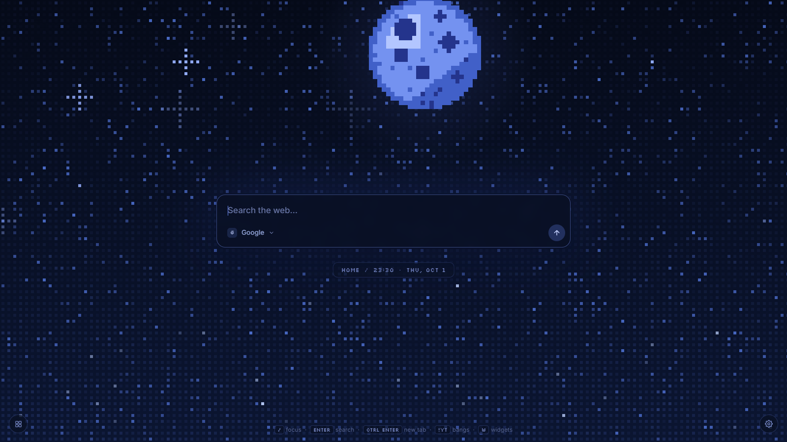

</div>

<br>

## Highlights

- **A sky that keeps time** — morning, day, evening and night palettes blend with the local clock; the pixel sun and moon arc across the screen.
- **12 backgrounds × 12 themes** — Scene, Aurora, Retro, Lamp, Dither, Halftone, Particles and more, every one theme- and phase-aware.
- **An omnibox, not just a box** — autocomplete, bangs (`!yt`, `!gh`, …), recent searches, URL detection, an instant calculator, and your open tabs and bookmarks.
- **Live weather** — temperature in the pill and rain, snow, fog or storms drawn into the scenery, via [Open-Meteo](https://open-meteo.com) with no API key.
- **Private by design** — no accounts, no telemetry; everything lives in `localStorage` / IndexedDB on your machine.
- **Zero dependencies** — plain HTML, CSS and JavaScript. No bundler, no framework, nothing to build.

## Screenshots

<table>
  <tr>
    <td width="50%">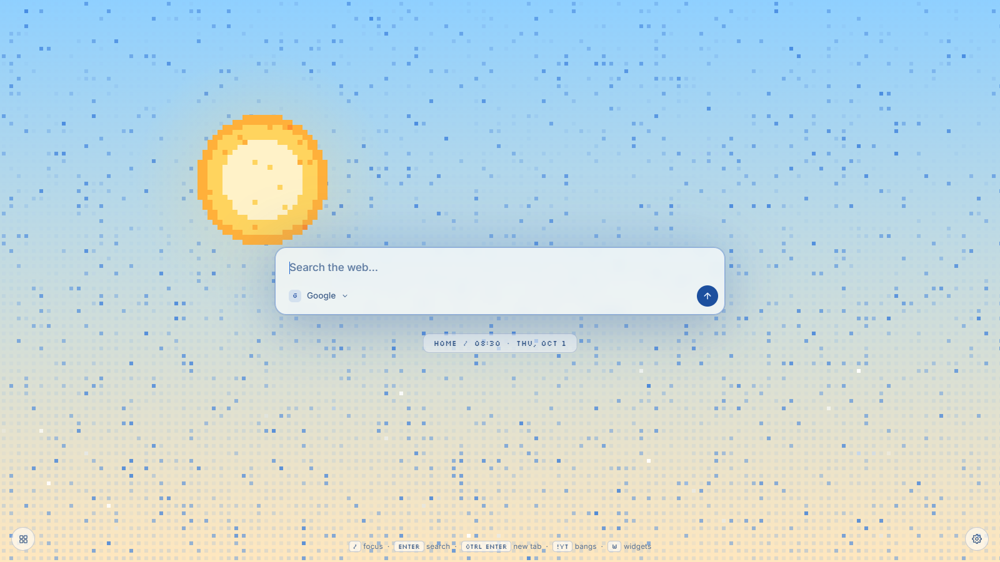</td>
    <td width="50%">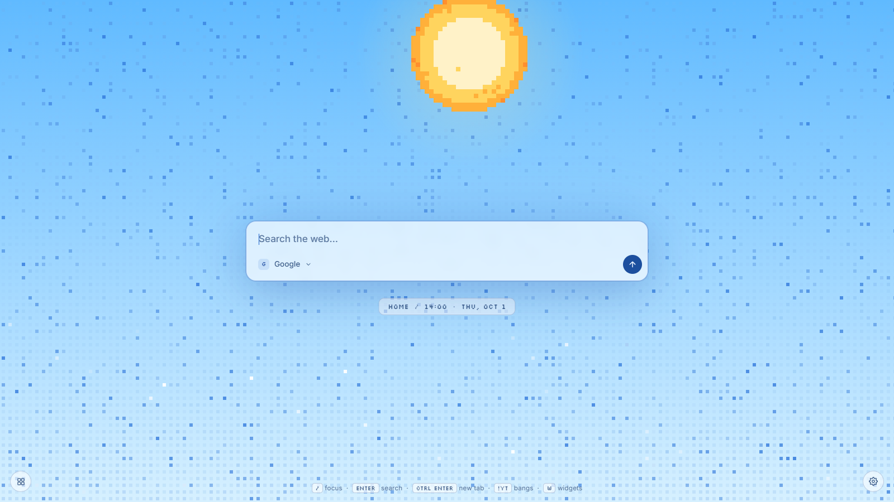</td>
  </tr>
  <tr>
    <td align="center"><sub><b>Morning</b> · 06–11</sub></td>
    <td align="center"><sub><b>Day</b> · 11–17</sub></td>
  </tr>
  <tr>
    <td width="50%">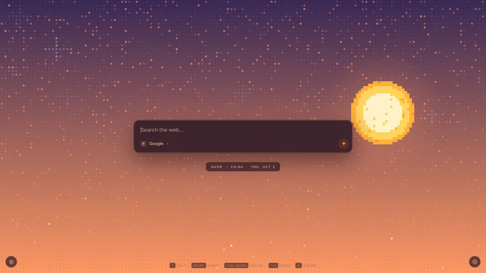</td>
    <td width="50%">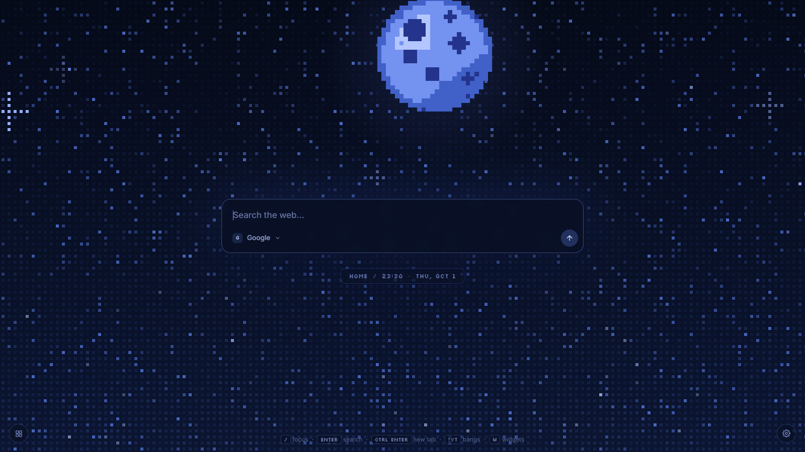</td>
  </tr>
  <tr>
    <td align="center"><sub><b>Evening</b> · 17–21</sub></td>
    <td align="center"><sub><b>Night</b> · 21–06</sub></td>
  </tr>
</table>

### Backgrounds & themes

<table>
  <tr>
    <td width="25%">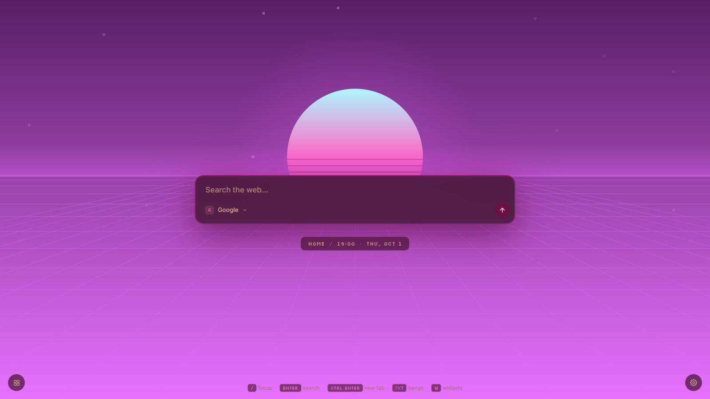</td>
    <td width="25%">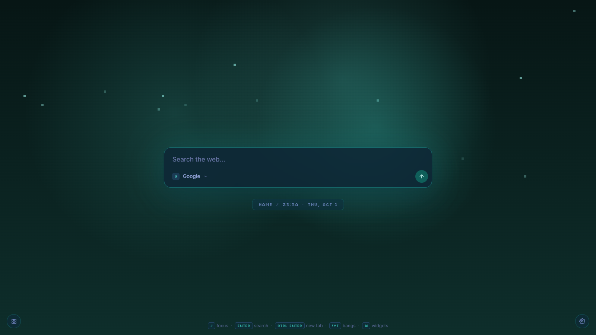</td>
    <td width="25%">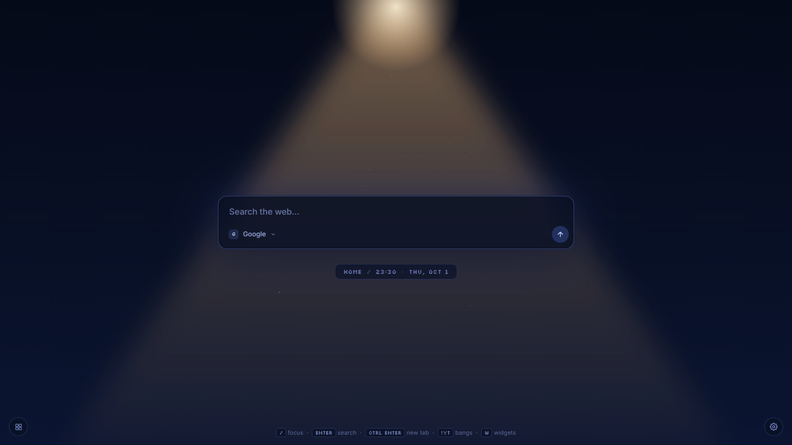</td>
    <td width="25%">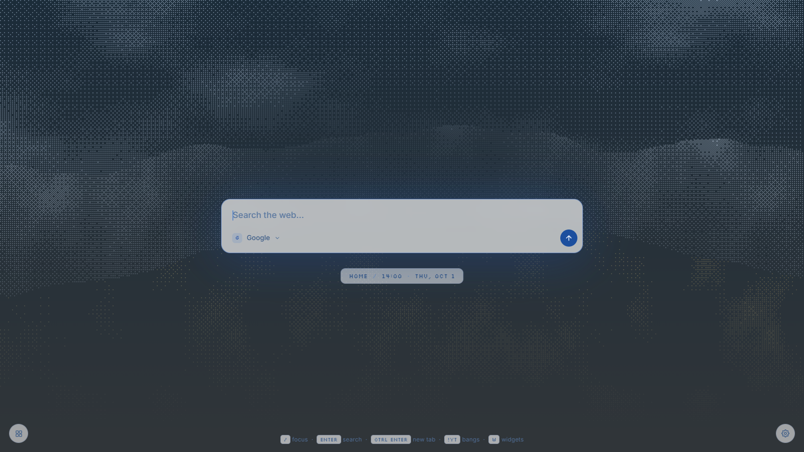</td>
  </tr>
  <tr>
    <td align="center"><sub><b>Retro</b> · Cyberpunk</sub></td>
    <td align="center"><sub><b>Aurora</b> · Teal</sub></td>
    <td align="center"><sub><b>Lamp</b> · night</sub></td>
    <td align="center"><sub><b>Dither</b> · Classic</sub></td>
  </tr>
  <tr>
    <td>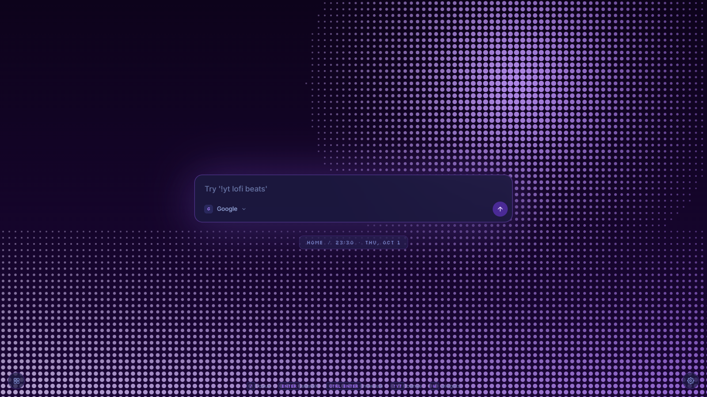</td>
    <td>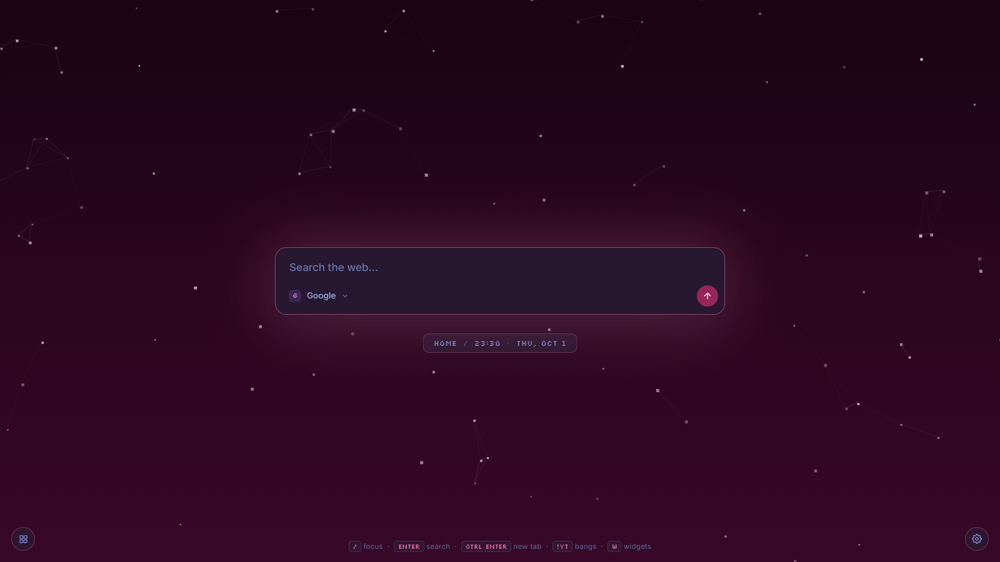</td>
    <td>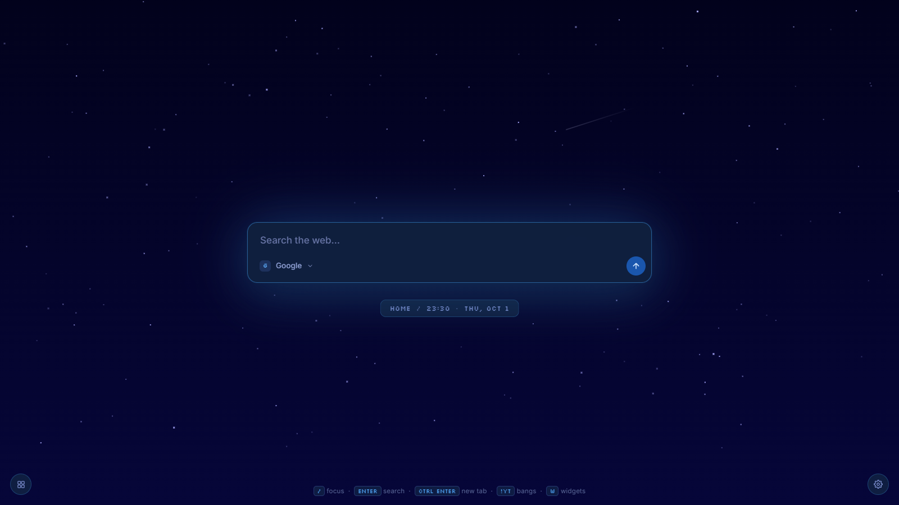</td>
    <td>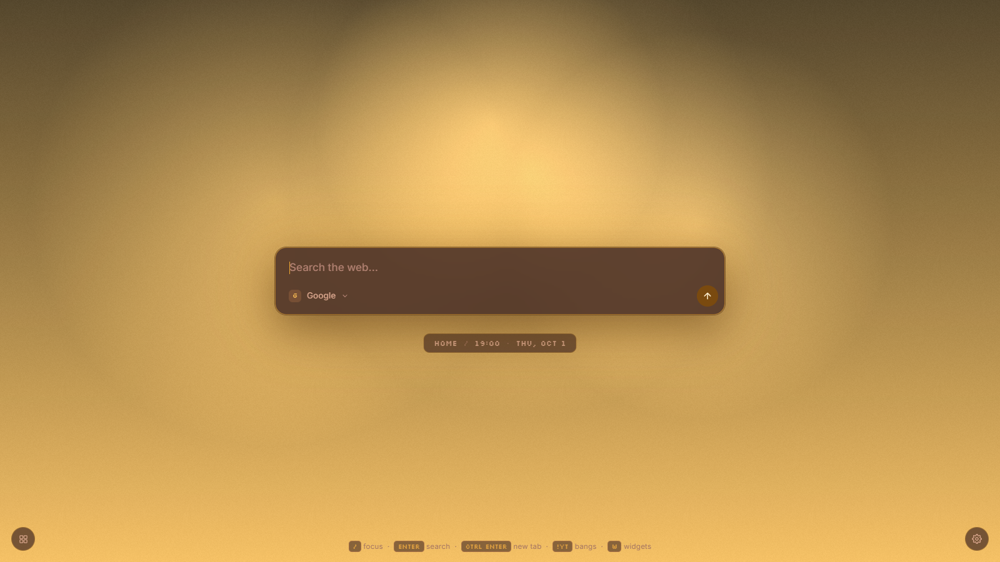</td>
  </tr>
  <tr>
    <td align="center"><sub><b>Halftone</b> · Violet</sub></td>
    <td align="center"><sub><b>Particles</b> · Rose</sub></td>
    <td align="center"><sub><b>Shooting</b> · Blue</sub></td>
    <td align="center"><sub><b>Grain</b> · Amber</sub></td>
  </tr>
</table>

### In use

<table>
  <tr>
    <td width="50%">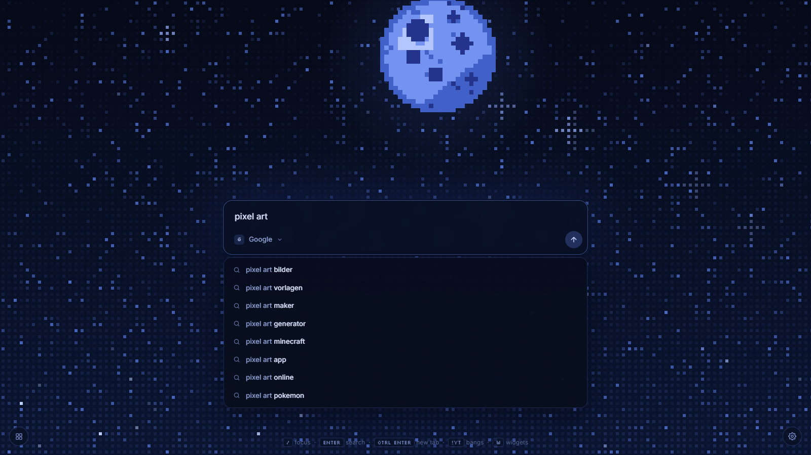</td>
    <td width="50%">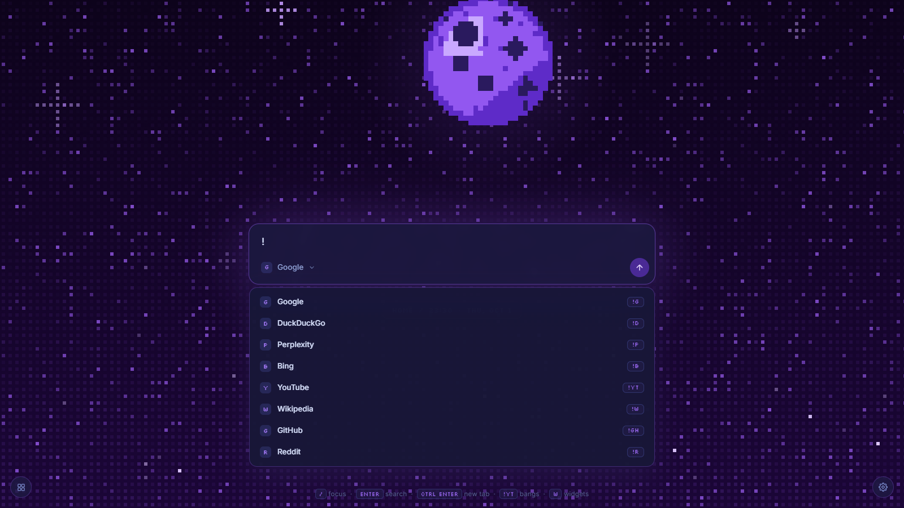</td>
  </tr>
  <tr>
    <td align="center"><sub><b>Autocomplete</b> — debounced, cached, keyboard-driven</sub></td>
    <td align="center"><sub><b>Bangs</b> — type <code>!</code> to search another site</sub></td>
  </tr>
  <tr>
    <td>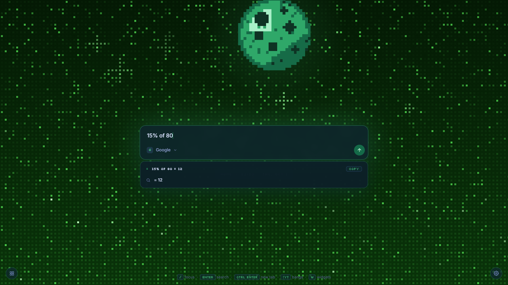</td>
    <td>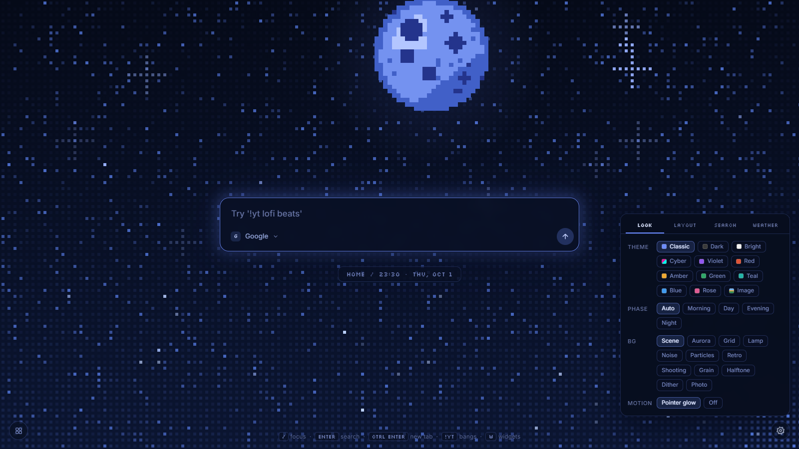</td>
  </tr>
  <tr>
    <td align="center"><sub><b>Instant calculator</b> — <code>Enter</code> copies the answer</sub></td>
    <td align="center"><sub><b>Settings</b> — theme, phase, background, motion</sub></td>
  </tr>
  <tr>
    <td>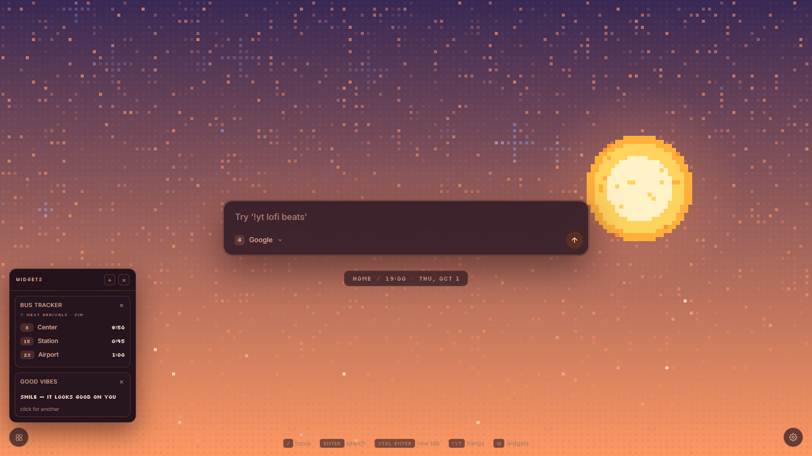</td>
    <td valign="middle">
      <b>Widget layer</b><br>
      <sub>Press <kbd>W</kbd> for a HUD of small persistent widgets — a bus tracker,
      “good vibes” reminders, or your own via <a href="#personal-mods-local-only"><code>mods.js</code></a>.</sub>
    </td>
  </tr>
</table>

## Installation

> [!TIP]
> Just want a look? The [**live demo**](https://amoralchik.github.io/homepage/) runs the same page in any browser — no install needed.
> Outside the extension the quick bar is hidden and autocomplete falls back to Google's JSONP endpoint; everything else is identical.

### As the New Tab page (recommended)

1. Clone or [download](https://github.com/Amoralchik/homepage/archive/refs/heads/main.zip) this repository.
2. Open `chrome://extensions` and turn on **Developer mode** (top right).
3. Click **Load unpacked** and select the project folder.
4. Open a new tab — done.

### As the Home / startup page

- **Home button:** `chrome://settings/appearance` → enable *Show home button* → enter the `file:///` URL of `index.html`.
- **On startup:** `chrome://settings/onStartup` → *Open a specific page* → add the same `file:///` URL.

> [!NOTE]
> Chrome doesn't let a plain settings URL replace the new-tab page — the unpacked extension is the only way to get a true new-tab override.

### Local development

```bash
python serve.py   # http://localhost:8419 — serves the folder with no-cache headers
```

Append `?phase=morning` / `day` / `evening` / `night` to preview a phase without waiting for the clock.

## Features

<details open>
<summary><b>Search</b> — providers, bangs, history, autocomplete</summary>

<br>

- **Providers:** Google · DuckDuckGo · Perplexity. The choice is remembered; <kbd>Alt</kbd>+<kbd>↑</kbd>/<kbd>↓</kbd> switches engine without leaving the box.
- **Bangs:** start (or end) a query with a bang to search elsewhere — `!yt lofi beats`, `rust lifetimes !so`. Typing `!` lists them (<kbd>Tab</kbd> completes one) and a bang alone (`!gh`) opens the site. The chip on the left follows the active bang.

  | Bang | Site | Bang | Site | Bang | Site |
  |---|---|---|---|---|---|
  | `!g` | Google | `!yt` | YouTube | `!so` | Stack Overflow |
  | `!d` | DuckDuckGo | `!w` | Wikipedia | `!mdn` | MDN |
  | `!p` | Perplexity | `!gh` | GitHub | `!npm` | npm |
  | `!b` | Bing | `!r` | Reddit | `!a` | Amazon |
  | `!m` | Maps | `!i` | Images | `!tr` | Translate |
  | `!x` | X | | | | |

- **Recent searches:** kept locally (never synced). Click into the empty box or press <kbd>↓</kbd> to see them; matching ones float to the top with a clock icon. Remove one with <kbd>×</kbd> or <kbd>Shift</kbd>+<kbd>Delete</kbd>.
- **Autocomplete:** suggestions after two characters, Google-style. Google and DuckDuckGo use their own APIs, the rest fall back to Google's. Requests are debounced, cached and aborted when superseded; offline, typing still works.
- **Omnibox behaviour:** URL-shaped input (`github.com`, `localhost:3000`) shows an **OPEN LINK** row — `https://` is added for you.
- **Instant calculator:** `4+4`, `2^10`, `sqrt(16)`, `15% of 80`, `sin(pi/2)`, `log2(1024)`, `3x4`, `2pi`… A small hand-written parser — nothing is ever `eval`'d.
- **Tabs & bookmarks** *(extension only)*: matches open tabs (**SWITCH TO TAB**) and bookmarks (**BOOKMARK**), like Chrome's omnibox.
- **Animated placeholder:** cycles through hint phrases while the box is empty (static under `prefers-reduced-motion`).

</details>

<details>
<summary><b>Day / night cycle</b> — phases, sun and moon</summary>

<br>

| Phase | Hours | Sky |
|---|---|---|
| Morning | 06–11 | warm and sunny |
| Day | 11–17 | clear blue |
| Evening | 17–21 | dusky orange |
| Night | 21–06 | starry, with the moon |

The sun (06–21) and moon (21–06) travel left → right, arcing high at mid-phase. Panel, text and accents adapt per phase and blend near boundaries; phases re-evaluate every 30 seconds, so a tab left open rolls over on its own. Freeze a phase in **Settings → Look → Phase**, or preview with `?phase=…` / `CONFIG.forcePhase`.

</details>

<details>
<summary><b>Backgrounds</b> — 12 styles</summary>

<br>

| Style | Description |
|---|---|
| **Scene** | The default pixel world — flickering grid, twinkling stars, sun and moon |
| **Aurora** | Drifting light blobs |
| **Grid** | Clean graph paper that drifts slowly, with glowing intersections |
| **Lamp** | A warm light cone that follows the clock, with dust motes in the beam |
| **Noise** | Film grain over a slowly breathing light |
| **Particles** | Floating dust linking into faint constellations |
| **Retro** | Synthwave floor with a striped sun sinking into the horizon |
| **Shooting** | Dense starfield with occasional meteors |
| **Grain** | Vivid gradient with film grain |
| **Halftone** | Your wallpaper as glowing dot-matrix art |
| **Dither** | Bayer-dithered pixel art of your wallpaper, fading out behind the search |
| **Photo** | Your wallpaper as-is, with a slow drift and a phase-tinted veil |

Every background is theme- and phase-aware — except the Lamp, which ignores the theme picker like a real lamp would.
**Pointer effects:** grids, dots, dither pixels and particles light up around the cursor and clicks send a ripple through the scene (off under **Look → Motion** or with `prefers-reduced-motion`).

</details>

<details>
<summary><b>Themes & wallpaper</b></summary>

<br>

- **Themes:** Classic, Dark, Bright, Cyberpunk, Violet, Red, Amber, Green, Teal, Blue, Rose — each recolours the planet, glow, sky, grid, stars and UI accents while the day cycle keeps running.
- **Image theme:** samples your wallpaper's dominant colour (accent, planet) and a second distinct hue (sun, borders); mostly-gray pictures give a neutral monochrome theme.
- **Wallpaper:** pick a file, drag & drop or paste a URL — stored locally in IndexedDB, never synced. Used by **Photo**, **Halftone** and **Dither**.

</details>

<details>
<summary><b>Weather</b></summary>

<br>

A pixel icon and temperature in the time pill, powered by [Open-Meteo](https://open-meteo.com) (free, no key, no account).

- **Location:** *Auto* uses browser geolocation and silently falls back to a coarse IP city lookup; *Pick…* searches Open-Meteo's city index.
- **In the scenery:** rain streaks with wind, drifting snow, pixel clouds, fog banks and lightning — on every background.
- **Freeze it:** pin the condition (Clear, Clouds, Rain, Snow, Storm, Fog) and temperature, just like freezing the phase.
- Refreshes every 10 minutes while visible; the last reading is cached so the pill fills in instantly. Works on the hosted demo too.

</details>

<details>
<summary><b>Quick bar</b> <i>(extension only)</i></summary>

<br>

A line of shortcuts pinned to the top of the page:

- **Recent** — the tabs you had open last, across windows; click to focus that exact tab.
- **Most used** — your top sites, ranked by a tiny background tracker of tab activations and page loads.
- **Bookmarks** — mirrors your bookmarks bar, with real folder nesting, item counts and **Open all**.

Overflow tucks into a "··· more" chip, favicons come from Chrome's cache, and the bar is fully keyboard-navigable (<kbd>←</kbd>/<kbd>→</kbd> between chips, <kbd>↓</kbd> opens a menu, <kbd>Esc</kbd> closes).

</details>

<details>
<summary><b>Settings & layout</b></summary>

<br>

The gear in the bottom-right opens a tabbed panel — **Look** (theme, phase, background, wallpaper, motion), **Layout** (pill text, 24h / 12h / seconds clock, show/hide toggles, quick bar), **Search** (default engine, where results open, suggestions, history, bang cheat sheet) and **Weather**. Only the knobs that matter for the current background are shown.

**Show/hide** toggles the planet, stars, search input, time pill, help dock and the pulsing search border — for a completely minimal (or maximal) layout. **Reset all settings…** wipes everything.

</details>

## Keyboard shortcuts

| Keys | Action |
|---|---|
| <kbd>/</kbd> or <kbd>Ctrl</kbd>+<kbd>K</kbd> | Focus the search box |
| <kbd>Enter</kbd> | Search / open link / copy calculator result |
| <kbd>Ctrl</kbd>+<kbd>Enter</kbd> or <kbd>Alt</kbd>+<kbd>Enter</kbd> | Open in a new tab |
| <kbd>Shift</kbd>+<kbd>Enter</kbd> | Open in a background tab |
| <kbd>Alt</kbd>+<kbd>↑</kbd> / <kbd>↓</kbd> | Switch search engine |
| <kbd>↑</kbd> / <kbd>↓</kbd> | Move through suggestions |
| <kbd>Tab</kbd> | Complete a bang |
| <kbd>Shift</kbd>+<kbd>Delete</kbd> | Remove a recent search |
| <kbd>Esc</kbd> | Dismiss suggestions / close panels |
| <kbd>W</kbd> | Toggle the widget layer |

## Privacy & permissions

No accounts and no telemetry. All settings, history and wallpapers stay on your machine.

| Permission | Why |
|---|---|
| `tabs` | Quick bar *Recent* mode and "switch to tab" (Chrome labels this *Read your browsing activity*) |
| `bookmarks` | Quick bar *Bookmarks* mode and bookmark matches in the search box |
| `favicon` | Reads Chrome's local favicon cache |
| `storage` | Keeps the local tab/site counts behind *Most used* |
| `geolocation` | Only when weather location is set to *Auto* — decline and it falls back to an IP city lookup |

The only network calls are search suggestions, Open-Meteo (forecast and city search) and [ipwho.is](https://ipwho.is) (IP fallback).

<details>
<summary>Autocomplete outside the extension</summary>

<br>

As an installed extension, suggestions load via `fetch` using the manifest's `host_permissions`. Opened as a plain `file://` or served page those fetches are CORS-blocked, so the page falls back to Google's JSONP suggest endpoint — same suggestions, no install needed.

</details>

## Customizing

| What | Where |
|---|---|
| Search providers | `PROVIDERS` array in `app.js` (name, letter chip, URL template) |
| Bangs | `BANGS` array in `app.js` |
| Placeholder hints | `PLACEHOLDERS` array in `app.js` |
| Widgets | `WIDGETS` registry in `app.js` — `name`, `blurb`, `mount(body)` returning an optional cleanup |
| Grid look | `PITCH` / `SIZE` (spacing), `DIM` / `BRIGHT` (colours) in `app.js` |
| Theme palettes | `THEMES` in `app.js` (design notes in [THEME.md](THEME.md)) |

### Personal mods (local only)

Want a private widget that never lands in the repo? Create `mods.js` next to `index.html` — it's gitignored and loaded automatically if present:

```js
HOME_MODS.register('my-widget', {
  name: 'My widget',
  blurb: 'shows up in the layer’s + menu',
  mount(body) {
    // draw into body; return a cleanup function (optional)
  },
});
```

<details>
<summary>Example: a live De Lijn bus tracker</summary>

<br>

The default example tracks a specific stop with **real-time arrivals** from the official [De Lijn Open Data API](https://data.delijn.be) (free key from [developer.delijn.be](https://developer.delijn.be), kept in the gitignored `mods.js` / `.env`). It shows a green LIVE tag on real-time passages, pops a small alert when the next bus is within 30 minutes, and falls back to an editable timetable if the API is unreachable.

</details>

## Project structure

```
.
├── index.html       # page markup
├── style.css        # layout, search box, dropdown, pill, settings
├── app.js           # backgrounds, day cycle, search, settings, widgets
├── background.js    # service worker — counts tab/site usage for "Most used"
├── manifest.json    # Manifest V3 — makes the folder a load-unpacked extension
├── serve.py         # optional dev server with no-cache headers
├── THEME.md         # design notes for the background themes
└── docs/screenshots # images used in this README
```

## Contributing

Issues and pull requests are welcome — see [CONTRIBUTING.md](CONTRIBUTING.md) for local setup and guidelines.

## License

Released under the [MIT License](LICENSE).

<div align="center">
<br>
<sub>Built with plain HTML, CSS & JavaScript · inspired by the opencode launcher and Velora UI</sub>
</div>
